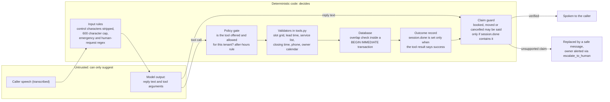
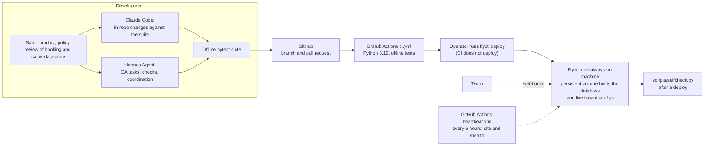

# Call Kettle

An AI phone receptionist for small home-service businesses. It answers the phone, books, moves and cancels appointments inside the hours the owner set, takes a message or puts the caller through to the owner, and gives the owner a portal with every booking, call summary and transcript.

The hard part is not the voice. It is putting a language model on a **public phone line**: anyone can call, speech recognition mishears names and numbers, the model can invent availability or say "you're booked" when nothing was saved, and every second of a call costs money while Twilio gives the server about 15 seconds to answer each turn. This codebase is mostly the machinery that makes that safe: the model only *suggests* actions, and deterministic code validates and performs them.

Deployed on Fly.io. Built and maintained by [Sami Ali](https://samiali38183.github.io/#also) with Claude Code and Hermes Agent as development tools (see [How it was built](#how-it-was-built)). There are no paying customers yet; end-to-end operation has been exercised with test calls from the developer's own numbers. This repository is a sanitized public snapshot of the application, exported on 2026-10-05: no secrets, production data, or private business documents. Later changes in the private codebase are not reflected here.

## Status

Levels follow the claim ladder the project's own agent rules use: **implemented** (code exists here), **tested** (covered by the offline suite in this repo), **deployed** (recorded in the project's private deployment notes as running in production; I cannot prove that from this repo alone). Nothing here is claimed beyond that.

| Area | Implemented | Tested offline | Deployed (per project notes) |
|---|---|---|---|
| Twilio voice webhooks with signature validation, TwiML flow, retry replay | yes | yes | yes |
| Claude tool-use agent: bounded loop, history repair, fail-over to the owner | yes | yes | yes |
| Server-side booking rules and double-booking protection in SQLite | yes | yes | yes |
| "Never claim an action that did not happen" guard | yes | yes (with a scripted fake model) | part of the deployed agent path; no separate production check recorded |
| Google Calendar free/busy read and event write (service account) | yes | partly (through failure and chaos tests) | yes: a spoken test call booked and cancelled an event in production, 2026-10-22 |
| iCal busy-time reader (read only) | yes | yes | not recorded |
| Owner portal and owner accounts (scrypt, lockout, CSRF) | yes | yes | yes |
| Owner notifications: email with `.ics`, ntfy push, SMS behind a flag | yes | yes | email: yes. SMS: flag-gated, see note below |
| Per-tenant spend and call ceilings, concurrency cap, repeat-caller limit | yes | yes | not recorded as a feature check |
| Cost observability ledger (measured provider usage) | yes | yes | not recorded |
| Outbound signed webhooks with a durable outbox | yes | yes | not recorded |
| Streaming speech-to-text (Media Streams + Deepgram adapter) | yes, **off by default** | yes, with a fake connection and recorded audio fixtures | exercised on real scripted test calls (2026-10-28, Gather vs streaming comparison); no customer tenant uses it |
| Encrypted offsite database backups | yes | yes | not configured |
| Stripe webhook state tracking | yes | yes | not recorded |
| Spanish calls | yes, beta, off by default | yes | no |
| Multi-instance session store (Redis) | planned | | |
| Two-way calendar sync beyond Google, Outlook/OAuth | planned | | |

SMS: the code can text the owner and, optionally, the caller. Carriers block unregistered US SMS, so it stays off unless `SMS_ENABLED=1`, and the agent is told not to promise texts.

## Architecture

### 1. One call, end to end


Default speech recognition is Twilio's `<Gather>`. A streaming path (Twilio Media Streams to a streaming STT provider) exists behind two flags and falls back to Gather on any error. It carried real scripted test calls on 2026-10-28 (a Gather-versus-streaming comparison); no customer tenant uses it.

### 2. Model suggests, code decides



### 3. Build, deploy and operate



Not in this repo: the Twilio voice-fallback function that rings the owner if the whole server is unreachable, and the deployment config.

## Engineering decisions

### The model suggests, the code decides

The agent (`backend/app/agent.py`) gives Claude a typed list of eight tools and runs the standard tool-use loop. What it does with the model's output is the interesting part.

- A tool the tenant disabled is not sent to the model at all (`tools_for`), and `_dispatch_tool` refuses it again if it is called anyway. The policy switches are typed (`Policy` in `config.py`), so `can_book: false` is enforced twice, not requested in a prompt.
- Whether the business is open right now is computed in code and passed to the model as one sentence (`_open_status_line`). The model is told not to recompute it, which removes a documented failure mode of this product category instead of instructing the model to avoid it.
- Anything safety-critical has a deterministic path that does not depend on the model noticing: possible emergencies (gas, fire, carbon monoxide, medical phrases, English and Spanish) trigger the 911 message and an owner alert, and an unambiguous "let me talk to a person" rings the owner (`_EMERGENCY_RE`, `_HUMAN_REQUEST_RE`). "Am I talking to a robot?" is separated from a transfer request and gets an honest answer.

### Server-side booking rules

`tools.book_appointment` treats every argument as hostile. In order: caller name present, date and time parse, the time is a real slot on the tenant's grid inside its booking hours, not in the past and at least 30 minutes away, phone number has 10 or more digits, the service is one the tenant actually offers (the duration comes from config, not from the model), the job finishes before closing, the slot is still free on the owner's connected calendars (a fresh read), and one call cannot book more than three slots.

The last line of defence is the database. `bookings` has `UNIQUE(client_id, slot_start)`, and `storage.create_booking` additionally runs an interval-overlap check inside a `BEGIN IMMEDIATE` write transaction, because the unique index alone would let a 60-minute job at 09:00 coexist with a 09:30 booking. A repeated identical request in the same call returns the existing booking instead of a conflict. Cancel and reschedule only touch a booking made in the same call or with the caller's own caller-ID number (`tools._owned`), never one the caller merely names.

### Never claim an action that did not happen

This is a hard invariant, enforced in `agent.py`, not a prompt instruction:

- `_record_outcome` adds `book`, `reschedule` or `cancel` to `session.done` only when the tool result contains `success: true` (a lookup that found appointments adds `lookup`).
- `claimed_actions` finds booked / cancelled / rescheduled claims in the text the model is about to say (English and Spanish patterns). `unsupported_claims` compares them to `session.done`.
- `_guard_claims` replaces an unsupported claim with a fixed safe message, records a `blocked_false_confirmation` metric, and calls `escalate_to_human` so the owner follows up. It runs on the normal reply and on the `end_call` closing message.
- If a tool raises, the loop substitutes an error result that tells the model to apologise and offer a human. A failed booking write returns an error that explicitly says not to say it is booked, and the owner is sent the caller's details so the lead is not lost.

`tests/test_truth_invariant.py` covers claims with no booking, cancel and reschedule claims, Spanish claims, a failed tool, a tool that raises, and closing messages, plus a set of ordinary sentences that must not be flagged. The guard is regex-based, so it is a backstop for the common phrasings rather than a proof; see Limitations.

### Per-tenant configuration and isolation

Each business is a YAML file validated by Pydantic (`config.py`). Validation happens at load, not mid-call: hours are normalised to `HH:MM` and refused if opening is not before closing, the timezone must be a real IANA zone, the opening line must disclose that the caller is talking to an AI, webhook URLs must be https with a secret, and demo-only options are rejected on real tenants. The `Policy` model is `extra: forbid`, so a typo'd policy key is an error. The top-level `ClientConfig` is not `extra: forbid` yet; an unknown top-level key is silently ignored (listed under Limitations).

`client_id` is validated against `[A-Za-z0-9_]{1,60}` before it becomes a file name. The owner portal never takes a tenant from a URL or form field: it comes from the signed-in session, and every query is parameterised with it. `tests/test_isolation.py` checks that updating or removing one tenant leaves another untouched, that the same slot can be booked for two tenants, that one tenant's dashboard key opens only its own dashboard, that one tenant's calls never appear on another's, that deleting a tenant erases only its data, and that hostile client ids are refused.

### Bounded work per turn and per call

Every unbounded thing has a limit in code. `cost_guard.MAX_TOOL_ITERATIONS_PER_TURN` is 4. Replies are capped at 220 output tokens, which also caps text-to-speech characters. The Anthropic client has a 6 second timeout and one retry, and no new model call starts once a turn has used 8 seconds, so the hand-off TwiML can still return inside Twilio's webhook deadline. Caller text is cut to 600 characters. Each tenant has `max_turns` and `max_call_seconds`. History is trimmed to 20 messages, always cutting on a caller's own words, never between a tool call and its result, and `repair_history` makes sure every `tool_use` has a matching `tool_result` before each model call, because the API rejects a broken history on every later turn of that call.

### Cost guard and observability

Two separate mechanisms. Enforcement (`costing.py`, `main.voice_incoming`) estimates a tenant's month from what each call recorded and compares it to a per-tenant ceiling: operator warnings at 75, 90 and 100 percent; past the ceiling, new calls get a message-taking flow with no model call, or ring the owner; past a further cap, calls are rejected before they are answered. There is also a cap on simultaneous calls per tenant and a limit of six calls from one number in ten minutes. The module states that the estimate is a smoke alarm, not an invoice.

Observability (`cost_observability.py`) is a separate ledger of *measured* provider evidence (token counts from the API's own usage fields, Twilio-reported seconds, counts of TwiML emitted). It records where each number came from, never writes "unknown" as zero, never enforces anything, and is wrapped so a failure cannot affect a call. `qa/token_benchmark.py` replays the real agent loop against a scripted fake client to measure prompt and tool-schema size before and after a change; it uses a characters-divided-by-four estimate and says so in its report.

### Calendars: Google, iCal, and `.ics`

`gcal.py` reads free/busy from a calendar the owner has shared with one service account and writes the booking as an event after it is saved. `icalbusy.py` reads the owner's private iCal feed as busy time (read only, no login). Both fail soft: if a calendar cannot be read, the assistant falls back to its own schedule instead of failing the call. Right before confirming, the slot is re-checked against both. Every booking, change and cancellation is also emailed to the owner as an `.ics` invite with the right method and sequence number. None of this is two-way sync, and the code says so.

### Notifications and outbound events

`notify.notify_owner` fans out to email, ntfy push and (flag-gated) SMS, each independent, none able to raise into a live call. Email goes through `mailer.py`, which records every send, suppresses addresses that hard-bounce, and uses idempotency keys. Tenants can also configure a signed outbound webhook (`webhooks.py`): events go to a SQLite outbox first, a background worker delivers them with growing retry delays over about 31 hours, event ids are stable so receivers can de-duplicate, requests are HMAC-signed with a timestamp, and the target must be https and resolve only to public addresses (re-checked before every attempt, redirects never followed).

### Owner portal

`portal.py` is server-rendered HTML with no JavaScript and no external requests. `owner_auth.py` binds one account to one tenant, hashes passwords with scrypt and a per-user salt, locks an account after repeated failures (counters in SQLite so they survive a restart) while answering identically for unknown and locked accounts, stores only hashes of session tokens, and carries a CSRF token per session. CSV exports neutralise spreadsheet formulas. Owners can mark a callback "not a customer" (`spamtag.py`); that stops pages for that caller ID but never suppresses an emergency.

### Failure handling and fallbacks

The rule is that a caller is never left with an error or dead air.

- Model API error, malformed response, or an exhausted tool loop: the agent escalates, alerts the operator (rate-limited), and transfers the live call to the owner's phone if the tenant allows transfers and the number is dialable; otherwise it promises a callback.
- Any unhandled exception on a `/voice/*` route is caught and answered with TwiML that dials the owner (`_voice_safety_net`).
- An unanswered transfer is recorded as an escalation and the caller is handed back to the agent to leave a message (`/voice/transfer-result`).
- Duplicate Twilio deliveries replay the stored response (`I-Twilio-Idempotency-Token`), and a per-call lock stops overlapping turns from corrupting history.
- After a restart, `recover_session` rebuilds turn count, start time, bookings made and, for tenants that keep transcripts, the conversation from the database.
- The live-call database path has a short busy timeout and a circuit breaker, so a locked database costs a measurement or a transcript line rather than holding a caller.
- Side effects after a saved booking (calendar write, SMS, notifications) are best effort: a failure is counted in `metrics` and never turns a saved booking into a reported failure.

More detail, module by module, is in [docs/ARCHITECTURE.md](docs/ARCHITECTURE.md).

## How it was built

Call Kettle was built by Sami Ali using two coding agents as development tools. Neither is part of the product at runtime; the runtime model is Claude Haiku called through the Anthropic API.

- **Claude Code** works inside the repo: implementation, refactors under the existing suite, regression tests for reported bugs. `CLAUDE.md` and `AGENTS.md` hold the rules it works under (no secrets, no invented metrics or customers, run the suite after every edit, do not delete tests to get a green run).
- **Hermes Agent** is a local agent runtime used for task-driven QA, repo chores, scheduled health checks and status briefs, and as the reviewer responsible for integration and for claim levels (what may be called implemented, tested or deployed). Parallel agent sessions were coordinated with a lane-and-claims board so two sessions did not edit the same files.
- **Sami** owns the product decisions, the policy model (what the AI may and may not do on a call), and review of anything touching bookings or caller data.

What that does and does not show: agents did a large share of the implementation and test writing under direction, and the repository's test suite and review rules are what kept their changes honest. It is not an autonomous system, and agent-written code is not trusted because an agent wrote it. [docs/AGENT_WORK.md](docs/AGENT_WORK.md) has the details.

## Limitations

- **Call state is in memory.** One process, one machine. Restarts mid-call are recovered from the database, but running two instances needs a shared session store first.
- **The claim guard is pattern based.** It covers booked, cancelled and rescheduled claims in common phrasings, English and Spanish. A paraphrase it does not match, or a different kind of false claim ("a technician is on the way"), would only be caught by the prompt, not by code.
- **Some policy switches are prompt-level.** `can_book`, `can_reschedule`, `can_cancel` and `can_transfer` are enforced in code. `can_quote`, the dispatch-fee text and address collection are prompt rules, so they are only as strong as the model.
- **`ClientConfig` is not `extra: forbid`.** Only `Policy` is. A misspelled top-level key in a tenant YAML is ignored rather than rejected.
- **Outbound URL checks can race DNS.** `url_is_safe` resolves the host and refuses non-public addresses, but the HTTP client resolves the name again when it connects, so a DNS-rebinding host could answer differently the second time. Redirects are not followed, and webhook URLs are set by the operator, which narrows exposure, but the gap is real. Planned fix: resolve once, connect to the validated address, and pass the original hostname as the TLS SNI/Host so certificate checks still apply.
- **Speech recognition is the weak link.** The default path is Twilio's recognizer; names and numbers get misheard. The prompt forces a spelled-out confirmation of names and a read-back, but there is no recognition-quality evaluation in this repo. The streaming path has been compared with Gather on scripted test calls only; no customer tenant uses it.
- **Calendars.** Google works through a shared service account. iCal is read only. No Outlook or Apple API integration, no per-owner OAuth.
- **Cost figures are estimates**, by design, and say so.
- **Not a compliance claim.** There are no BAAs and no certifications. Tenants in health or legal fields can run with `record_transcripts: false`, which reduces exposure and does not make the system HIPAA-compliant.
- **English by default.** Spanish is a beta, off unless a tenant enables it.
- **No latency or load benchmarks are published here.** The 8 second turn budget is a cap, not a measurement. `scripts/load_test.py` exists but needs live credentials.
- **This is a sanitized snapshot.** 101 of the tests fail here for snapshot reasons and are marked as expected failures (see Tests). The snapshot is dated 2026-10-05. Private operator tooling, sales and marketing material, the voice-fallback function and deployment config are not included, so some scripts and tests that read them cannot run here.

## Roadmap

Not built yet, in rough priority order:

1. A shared session store so the app can run on more than one instance.
2. `extra: forbid` on `ClientConfig`, after checking every tenant file against it.
3. Broader claim detection (semantic check of the reply against the tool log instead of phrase patterns), with a labelled set of real and false confirmations to measure it.
4. A recognition-quality evaluation on realistic call audio, then a controlled pilot of the streaming path.
5. Restore the 101 snapshot-only test failures by rebuilding their fixtures.
6. Calendar integrations beyond Google service-account sharing.

## Run locally

Requires Python 3.12 (as used in CI).

```bash
cd backend
python -m venv .venv
# Windows: .venv\Scripts\activate    macOS/Linux: source .venv/bin/activate
pip install -r requirements.txt -r requirements-dev.txt
cp .env.example .env        # then fill in values locally; never commit .env
uvicorn app.main:app --reload
```

`.env.example` lists `ANTHROPIC_API_KEY`, the Twilio credentials, `CALLKETTLE_DB_PATH` and `LOG_LEVEL`. `CALLKETTLE_SKIP_SIGNATURE_CHECK=1` is for local development only; it disables Twilio request validation. `backend/simulate_call.py <client_id>` drives a conversation from the terminal against the real agent and tools; it makes real model calls, so it needs an Anthropic key and costs a little. Sample tenants are in `backend/clients/`; they are fictional and carry placeholder contact values (`owner@example.com`, `YOUR-NTFY-TOPIC`). Set your own before running anything that notifies.

## Tests

```bash
cd backend
CALLKETTLE_SKIP_SIGNATURE_CHECK=1 ANTHROPIC_API_KEY=dummy TWILIO_ACCOUNT_SID=dummy TWILIO_AUTH_TOKEN=dummy \
  python -m pytest -q
```

This is exactly what CI runs: offline, no network, no model calls (the agent is driven by fakes). Result of that command in a clean virtualenv built with the install line above, on Python 3.12.2 (Windows):

```
1448 passed, 1 skipped, 101 xfailed in 252.07s (0:04:12)
```

The suite has 92 test files. Heaviest areas: failure injection and chaos (`test_resilience_chaos.py`, 75 tests), the agent loop (`test_agent.py`, 54), outbound webhooks (`test_webhooks.py`, 45), streaming STT with fixtures (`test_stream_stt.py`, 34), cost observability (33), iCal (26), claim guard (`test_truth_invariant.py`, 23), failure handling (`test_failures.py`, 23), tenant isolation (`test_isolation.py`, 12).

About the 101 expected failures: this repository is a sanitized export of a larger private codebase. Those tests either read something the export left out (private modules, a sample tenant, sales and site files) or have fixtures the export rewrote (for example, two different people given one placeholder phone number). They are listed with the reason in `backend/tests/snapshot_known_failures.txt` and marked `xfail` in `backend/tests/conftest.py`, so they are counted and visible rather than hidden. Two further test files that cannot even be imported here are skipped at collection (`test_practice.py`, `test_sales_recheck.py`). Counts for the full private suite are not reproduced here.

## Repository map

| Path | What it is |
|---|---|
| `backend/app/` | The application: agent, tools, config, storage, portal, notifications, cost controls |
| `backend/clients/` | Fictional sample tenants (YAML) |
| `backend/tests/` | Offline pytest suite |
| `backend/qa/` | Offline benchmarks and a simulated-caller harness (the harness makes real model calls) |
| `backend/scripts/` | Operator and diagnostic scripts; several need live credentials |
| `docs/ARCHITECTURE.md` | Module-by-module walk-through |
| `docs/AGENT_WORK.md` | How the coding agents were used |
| `marketing/` | `pricing_audit.py`, a scanner for a configured private price in public text, and the small facts file it reads. The sales and site material is not in this repository |

## License

MIT. See [LICENSE](LICENSE).
