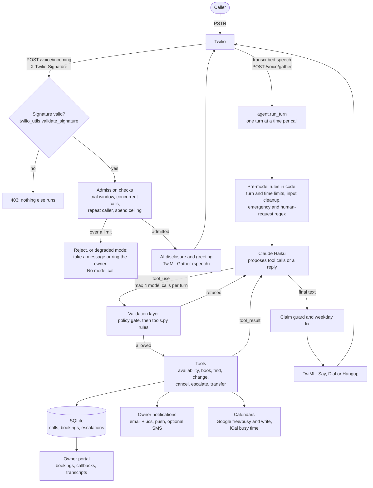
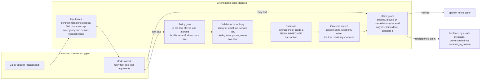
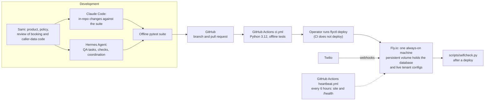

# Design notes

The call flow, the split between what the model suggests and what code decides, and the supporting mechanisms (limits, costs, calendars, notifications, portal, failure handling). Moved here from the README; [ARCHITECTURE.md](ARCHITECTURE.md) goes module by module and [SECURITY_INVARIANTS.md](SECURITY_INVARIANTS.md) lists the properties the server keeps.

## Architecture

### 1. One call, end to end

Speech recognition is Twilio's `<Gather>` by default. A streaming path (Twilio Media Streams to a streaming speech-to-text provider) sits behind two flags and falls back to Gather on any error. It handled scripted test calls on 2026-10-28 in a Gather-versus-streaming comparison, and no customer tenant uses it.

### 2. What the model can and can't decide

### 3. Build, deploy and operate

Not in this repo: the Twilio voice-fallback function that rings the owner if the whole server is unreachable, and the deployment config.

## How the code is built around the model

### The model suggests, the code decides

`backend/app/agent.py` gives Claude a typed list of eight tools and runs the usual tool-use loop. What matters is what the code does with the output.

- A tool the tenant turned off is never sent to the model (`tools_for`), and `_dispatch_tool` refuses it again if it is called anyway. The policy switches are typed (`Policy` in `config.py`), so `can_book: false` is enforced twice instead of being asked for in a prompt.
- Whether the business is open right now is worked out in code and passed to the model as one sentence (`_open_status_line`). The model is told not to recompute it. A model can get this wrong, so I didn't want to rely on a prompt for it.
- Safety-critical cases have a path that doesn't depend on the model noticing. Possible emergencies (gas, fire, carbon monoxide, medical phrases, in English and Spanish) trigger the 911 message and an owner alert, and an unambiguous "let me talk to a person" rings the owner (`_EMERGENCY_RE`, `_HUMAN_REQUEST_RE`). "Am I talking to a robot?" is kept apart from a transfer request and gets an honest answer.

### Booking rules on the server

`tools.book_appointment` treats every argument as hostile. It checks, in order:

1. The caller's name is present.
2. The date and time parse.
3. The time is a real slot on the tenant's grid, inside its booking hours, not in the past and at least 30 minutes away.
4. The phone number has 10 or more digits.
5. The service is one the tenant offers. The duration comes from config, not from the model.
6. The job finishes before closing.
7. The slot is still free on the owner's connected calendars (a fresh read).
8. One call has not already booked three slots.

The last line of defence is the database. `bookings` has `UNIQUE(client_id, slot_start)`, and `storage.create_booking` also runs an interval-overlap check inside a `BEGIN IMMEDIATE` write transaction. The unique index alone would let a 60-minute job at 09:00 sit next to a 09:30 booking. A repeated identical request in the same call returns the existing booking instead of a conflict. Cancel and reschedule only touch a booking made in the same call or with the caller's own caller-ID number (`tools._owned`), never one the caller just names.

### Never claim an action that did not happen

This is enforced in `agent.py`, not asked for in the prompt.

- `_record_outcome` adds `book`, `reschedule` or `cancel` to `session.done` only when the tool result contains `success: true`. A lookup that found appointments adds `lookup`.
- `claimed_actions` finds booked, cancelled and rescheduled claims in the text the model is about to say, with English and Spanish patterns. `unsupported_claims` compares them to `session.done`.
- `_guard_claims` swaps an unsupported claim for a fixed safe message, records a `blocked_false_confirmation` metric and calls `escalate_to_human` so the owner follows up. It runs on normal replies and on the `end_call` closing message.
- If a tool raises, the loop gives the model an error result that tells it to apologise and offer a human. If a booking write fails, the error says not to claim it is booked, and the owner is sent the caller's details so the lead isn't lost.

`tests/test_truth_invariant.py` covers claims with no booking, cancel and reschedule claims, Spanish claims, a failed tool, a tool that raises and closing messages. It also has ordinary sentences that must not be flagged. The guard is regex based, so it is a backstop for common phrasings and not a proof (see Limitations).

### Tenant configuration and isolation

Each business is a YAML file validated by Pydantic (`config.py`) when it loads, not in the middle of a call. Hours are normalised to `HH:MM` and refused if opening isn't before closing. The timezone has to be a real IANA zone. The opening line has to say the caller is talking to an AI. Webhook URLs must be https and carry a secret, and demo-only options are rejected on real tenants. `Policy` is `extra: forbid`, so a typo in a policy key is an error. `ClientConfig` is not `extra: forbid` yet, so an unknown top-level key is silently ignored (see Limitations).

`client_id` is checked against `[A-Za-z0-9_]{1,60}` before it becomes a file name. The owner portal never takes a tenant from a URL or form field. It comes from the signed-in session, and every query is parameterised with it. `tests/test_isolation.py` checks that:

- updating or removing one tenant leaves another untouched;
- the same slot can be booked for two tenants;
- one tenant's dashboard key opens only its own dashboard;
- one tenant's calls never show up on another's;
- deleting a tenant erases only its data;
- hostile client ids are refused.

### Limits on work per turn and per call

Everything that could run away has a limit in code. `cost_guard.MAX_TOOL_ITERATIONS_PER_TURN` is 4. Replies are capped at 220 output tokens, which also caps text-to-speech characters. The Anthropic client has a 6 second timeout and one retry, and no new model call starts once a turn has used 8 seconds, so the hand-off TwiML can still go back inside Twilio's deadline. Caller text is cut to 600 characters. Each tenant has `max_turns` and `max_call_seconds`. History is trimmed to 20 messages, always cutting on a caller's own words and never between a tool call and its result. `repair_history` makes sure every `tool_use` has a matching `tool_result` before each model call, because the API rejects a broken history and would keep rejecting it on every later turn of that call.

### Cost guard and observability

These are two separate mechanisms. Enforcement (`costing.py`, `main.voice_incoming`) estimates a tenant's month from what each call recorded and compares it to a per-tenant ceiling. The operator is warned at 75, 90 and 100 percent. Past the ceiling, new calls get a message-taking flow with no model call, or ring the owner. Past a further cap, calls are rejected before they are answered. There is also a cap on simultaneous calls per tenant and a limit of six calls from one number in ten minutes. The module says the estimate is a smoke alarm, not an invoice.

Observability (`cost_observability.py`) is a separate ledger of measured provider evidence: token counts from the API's own usage fields, Twilio-reported seconds and counts of TwiML emitted. It records where each number came from, never writes "unknown" as zero, never enforces anything, and is wrapped so a failure can't affect a call. `qa/token_benchmark.py` replays the real agent loop against a scripted fake client to measure prompt and tool-schema size before and after a change. It estimates tokens as characters divided by four and says so in its report.

### Calendars

`gcal.py` reads free/busy from a calendar the owner has shared with one service account, and writes the booking as an event after it is saved. `icalbusy.py` reads the owner's private iCal feed as busy time (read only, no login). Both fail soft: if a calendar can't be read, the assistant falls back to its own schedule instead of failing the call. The slot is checked against both again right before confirming. Every booking, change and cancellation is also emailed to the owner as an `.ics` invite with the right method and sequence number. None of this is two-way sync, and the code says so.

### Notifications and outbound events

`notify.notify_owner` sends to email, ntfy push and (behind a flag) SMS. Each channel is independent and none can raise into a live call. Email goes through `mailer.py`, which records every send, suppresses addresses that hard-bounce, and uses idempotency keys. A tenant can also set up a signed outbound webhook (`webhooks.py`). Events go to a SQLite outbox first, and a background worker delivers them with growing retry delays over about 31 hours. Event ids are stable so receivers can de-duplicate. Requests are HMAC-signed with a timestamp, and the target must be https and resolve only to public addresses. That is re-checked before every attempt, and redirects are never followed.

### Owner portal

`portal.py` is server-rendered HTML with no JavaScript and no external requests. `owner_auth.py` binds one account to one tenant and hashes passwords with scrypt and a per-user salt. It locks an account after repeated failures, with the counters in SQLite so they survive a restart, and answers the same way for unknown and locked accounts. It stores only hashes of session tokens and carries a CSRF token per session. CSV exports neutralise spreadsheet formulas. Owners can mark a callback "not a customer" (`spamtag.py`). That stops pages for that caller ID but never suppresses an emergency.

### Failure handling

The rule is that a caller never hears an error or dead air.

- If the model API errors, returns something malformed or the tool loop runs out, the agent escalates and alerts the operator (rate-limited). It then transfers the live call to the owner's phone if the tenant allows transfers and the number is dialable. Otherwise it promises a callback.
- Any unhandled exception on a `/voice/*` route is caught and answered with TwiML that dials the owner (`_voice_safety_net`).
- An unanswered transfer is recorded as an escalation, and the caller goes back to the agent to leave a message (`/voice/transfer-result`).
- Duplicate Twilio deliveries replay the stored response (`I-Twilio-Idempotency-Token`), and a per-call lock stops overlapping turns from corrupting history.
- After a restart, `recover_session` rebuilds the turn count, start time, bookings made and, for tenants that keep transcripts, the conversation from the database.
- The live-call database path has a short busy timeout and a circuit breaker, so a locked database costs a measurement or a transcript line and doesn't hold a caller.
- Side effects after a saved booking (calendar write, SMS, notifications) are best effort. A failure is counted in `metrics` and never turns a saved booking into a reported failure.

[docs/ARCHITECTURE.md](docs/ARCHITECTURE.md) goes through the modules one by one.
